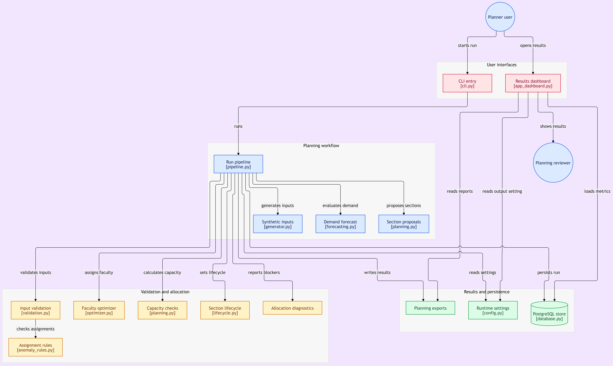

# System architecture

The platform is a synthetic academic-planning pipeline with two entry points: a command-line runner for generating and validating a planning run, and a Streamlit dashboard for reviewing exported or persisted results.

<div align="center">
  
  <br>
  <em>End-to-end application architecture. PostgreSQL persistence is optional; the CLI can run without a database.</em>
</div>

## At a glance

| Layer | Responsibility | Main implementation |
|---|---|---|
| User interfaces | Start a run or inspect its results | [`cli.py`](../src/academic_planner/cli.py), [`app_dashboard.py`](../app_dashboard.py) |
| Orchestration | Coordinate generation, forecast, planning, validation, allocation, and exports | [`pipeline.py`](../src/academic_planner/pipeline.py) |
| Synthetic inputs | Build seeded source tables and separate anomaly fixtures | [`generator.py`](../src/academic_planner/generator.py) |
| Forecasting | Evaluate a historical holdout and produce course demand forecasts | [`forecasting.py`](../src/academic_planner/forecasting.py) |
| Planning and allocation | Propose roomed sections and assign eligible faculty | [`planning.py`](../src/academic_planner/planning.py), [`optimizer.py`](../src/academic_planner/optimizer.py) |
| Validation and diagnostics | Enforce modeled rules, finalize lifecycle state, explain blockers | [`validation.py`](../src/academic_planner/validation.py), [`anomaly_rules.py`](../src/academic_planner/anomaly_rules.py), [`allocation_diagnostics.py`](../src/academic_planner/allocation_diagnostics.py), [`lifecycle.py`](../src/academic_planner/lifecycle.py) |
| Results and persistence | Write run artifacts, events, and optional relational records | [`pipeline.py`](../src/academic_planner/pipeline.py), [`database.py`](../src/academic_planner/database.py), [`schema.sql`](../src/academic_planner/schema.sql) |

## Planning-run flow

```text
CLI and run configuration
          |
          v
Seeded synthetic source data -----> Source validation
          |
          v
Historical holdout evaluation --> Course demand forecasts
                                      |
                                      v
                              Section proposals
                                      |
                         +------------+------------+
                         |                         |
                         v                         v
                 Room/time checks          Faculty CP-SAT assignment
                         |                         |
                         +------------+------------+
                                      v
                          Assignment/section validation
                                      |
                                      v
                      Final lifecycle and capacity ledger
                                      |
                   +------------------+------------------+
                   |                                     |
                   v                                     v
          Course-level unmet demand                Run exports/events
                                                         |
                                               +---------+---------+
                                               |                   |
                                               v                   v
                                     Streamlit dashboard     Optional PostgreSQL
```

The room/time checks and faculty allocation are related by the proposed section schedule, but are **not jointly optimized**. Room placement is a simple first-fit process; CP-SAT assigns faculty subject to modeled skill, availability, workload, and same-slot constraints. Validation runs before a section is counted as operational.

## Component responsibilities

### Interfaces and configuration

- The CLI selects starter or target dimensions, accepts a seed/output directory, and supports `--room-scarcity`. `--no-db` runs without PostgreSQL.
- The dashboard reads generated reports from the configured output location and can display persisted metrics when database access is configured.
- [`config.py`](../src/academic_planner/config.py) reads environment configuration such as `SEED`, `DATABASE_URL`, and `OUTPUT_DIR`; secrets belong in the local environment, not source control.

### Generation, forecasting, and section planning

1. [`generator.py`](../src/academic_planner/generator.py) creates synthetic academic terms, programs, courses, prerequisites, completions, faculty, skills, availability, rooms, plans, interests, and historical enrollments using a seeded random generator. Five ground-truth anomaly fixtures are exported separately from normal operational inputs.
2. [`forecasting.py`](../src/academic_planner/forecasting.py) chronologically orders historical terms, holds out the final historical term, compares a Random Forest with a last-observation baseline, and generates target-term forecasts. Sparse-history fallbacks are explicit in forecast output.
3. [`planning.py`](../src/academic_planner/planning.py) creates up to 40-seat section proposals and assigns abstract weekday/slot room placements. It then calculates per-section operational capacity, course-level accommodated demand, and unmet demand.

### Validation and faculty allocation

- [`validation.py`](../src/academic_planner/validation.py) checks generated source relationships and fields, terms and effective dates, prerequisite completion, proposed sections, and faculty assignments.
- [`optimizer.py`](../src/academic_planner/optimizer.py) uses OR-Tools CP-SAT to maximize assigned sections while enforcing at most one faculty assignment per section, active faculty status, effective course skill, term availability, weekly workload caps, and no repeated faculty assignment in the same term/day/slot.
- [`lifecycle.py`](../src/academic_planner/lifecycle.py) validates allowed transitions. Proposals begin as `PROPOSED`; final section states distinguish `OPERATIONAL`, `UNSTAFFED`, `BLOCKED`, and `REJECTED`.
- [`allocation_diagnostics.py`](../src/academic_planner/allocation_diagnostics.py) explains unstaffed sections and candidate blockers. [`anomaly_rules.py`](../src/academic_planner/anomaly_rules.py) checks assignment issue types.
- Only validated operational sections contribute operational seats. Unmet demand is calculated per course, so spare seats in a different course do not cancel a shortage.

### Exports and persistence

The pipeline writes source CSV/JSON files, manifests/checksums, forecasts, sections, assignments, validation reports, allocation diagnostics, operational capacity, unmet demand, evaluation metrics, and decision events. Each run is also archived below `runs/<planning_run_id>/`.

PostgreSQL is optional for the CLI. When persistence is enabled, [`database.py`](../src/academic_planner/database.py) initializes the schema, source tables are upserted, and run-scoped results and decision events are persisted according to [`schema.sql`](../src/academic_planner/schema.sql). Database integration tests require a dedicated disposable `TEST_DATABASE_URL`; see [README setup and test instructions](../README.md).

## Modeled constraints and boundaries

The current model checks:

- Section target capacity up to 40 seats and room capacity at least the planned capacity.
- No duplicate room assignment for the same term/day/slot.
- Active faculty with effective course skill and availability.
- Faculty weekly assignment hours within configured limits and no same-slot duplicate faculty assignment.
- Prerequisite completion for eligible/registered/waitlisted synthetic interests when completion records are present.
- Operational status only after required validations and staffing succeed.

The model does not include required room equipment/type matching, actual clock-time slot lengths or overlaps, student cohort timetable conflicts, or a joint room/faculty optimizer. The generated dates and data are synthetic. Solver status `OPTIMAL` only describes the encoded objective and constraints; it does not guarantee every proposal becomes operational.

For chosen algorithms, assumptions, current generated metrics, and known trade-offs, see [Design decisions](DESIGN_DECISIONS.md). For current verified results, see the [acceptance audit](../reports/acceptance_audit_20261029.md).
